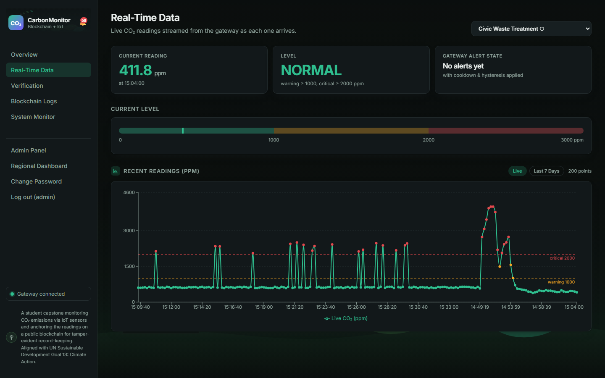
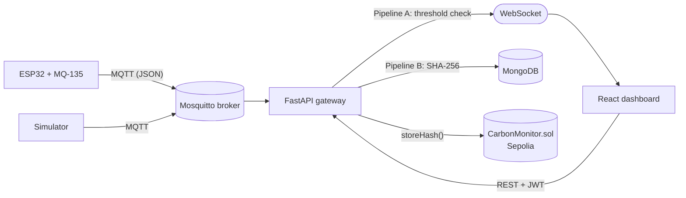
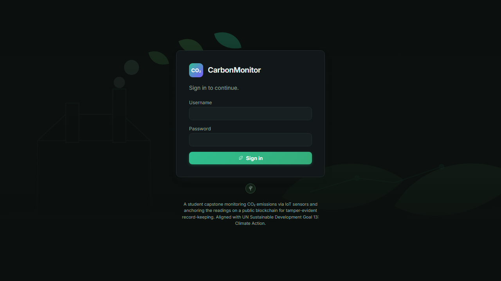
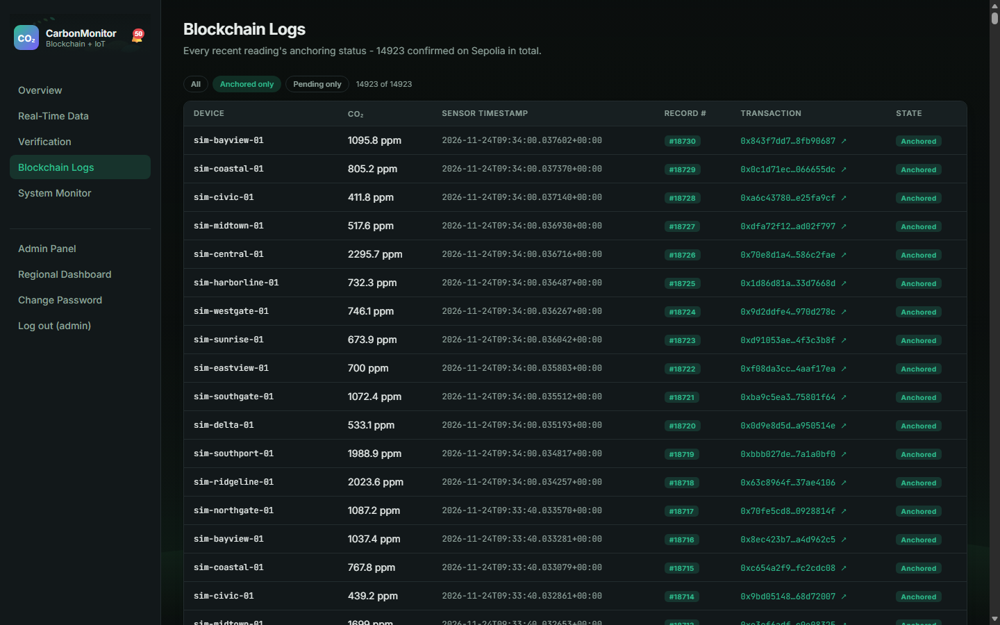
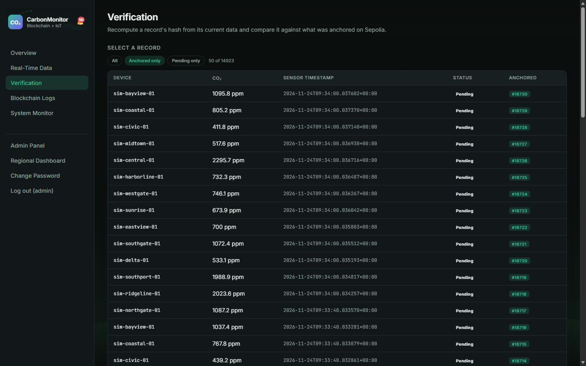
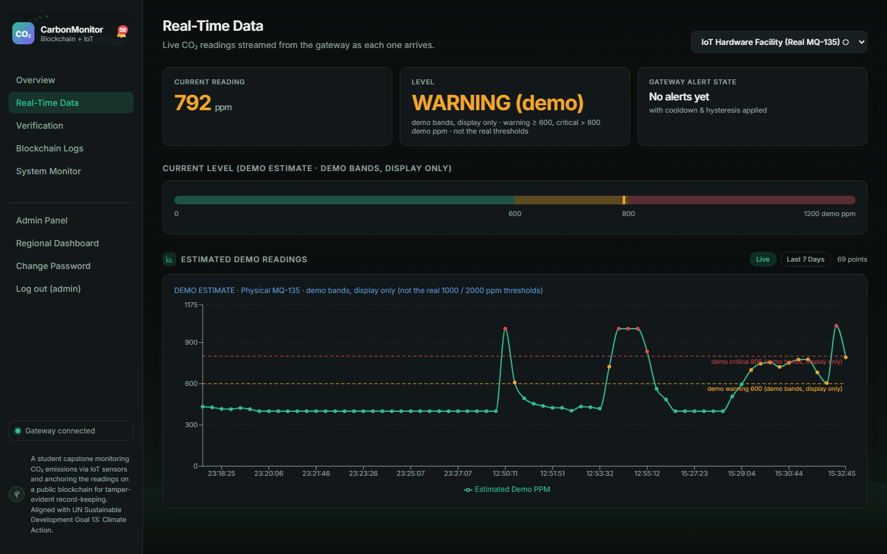

<div align="center">

# CarbonMonitor

**Real-time CO₂ emission monitoring with blockchain-anchored data integrity.**

An IoT sensor node, a FastAPI gateway, an Ethereum smart contract and a React dashboard,
working together to answer two questions: *is the air over the limit right now?* and
*can the history be trusted?*




</div>

> **Status:** a final-year engineering capstone **prototype**, built to be demonstrated, not a
> production system. Aligned with UN Sustainable Development Goal 13: Climate Action.

---

## What it does

1. **Real-time threshold alerting.** Sensor readings stream over MQTT, are checked against
   configurable WARNING / CRITICAL thresholds, and reach the dashboard over a WebSocket within
   moments. The alert path never waits on the database or the blockchain.
2. **Tamper-evident history.** Every reading is hashed with SHA-256, stored in MongoDB, and its
   hash is anchored on the Ethereum Sepolia testnet. Re-hashing a stored record and comparing it
   with the on-chain hash shows whether the data was altered after the fact.

## Features

| | |
|---|---|
| **Live monitoring** | Current reading, level gauge and rolling chart per factory, with a 7-day history view |
| **Alerting** | WARNING / CRITICAL levels with hysteresis, so alerts don't flap near a threshold; alerts resolve automatically |
| **Notifications** | Region-scoped, saved server-side, delivered live through a bell and toasts, with *seen* / *acknowledge* |
| **Blockchain anchoring** | SHA-256 → MongoDB → Sepolia, in a background pipeline separate from the alert path |
| **Verification** | Recompute a record's hash and compare it with the on-chain value; a mismatch marks the record *Tampered* and raises a critical tampering event |
| **Automatic tamper checks** | A scheduler periodically re-verifies a small sample of recently anchored records |
| **Roles and regions** | `admin` sees everything; `regional_head` sees only their own region (JWT, enforced on every request) |
| **Admin panel** | Users, regions, factories and devices, system health, blockchain status, audit log |
| **Real hardware** | ESP32 + MQ-135 node with a local buzzer alarm that does not depend on MQTT or the gateway |
| **Simulator** | Publishes randomised readings for every simulated factory, spanning normal to critical levels |

## Architecture



Every MQTT message feeds **two independent pipelines**:

- **Pipeline A (fast):** threshold check → WebSocket alert. It never waits on hashing, MongoDB
  or the blockchain.
- **Pipeline B (background):** SHA-256 → MongoDB → Sepolia transaction, as a separate asyncio
  task. A slow or failing chain call cannot delay an alert.

More detail (message formats, hashing, data model, verification, RBAC) is in
[docs/ARCHITECTURE.md](docs/ARCHITECTURE.md).

## A tour of the dashboard

| | |
|---|---|
|  |  |
| **Sign in.** JWT sessions, scoped by role and region. | **Blockchain Logs.** Every reading's anchoring state, with a link to its Sepolia transaction. |
|  |  |
| **Verification.** Recompute a record's hash and compare it with the chain. | **Hardware node.** The real ESP32's readings, in presentation demo mode (see below). |

## Tech stack

| Layer | Technology |
|---|---|
| Sensing | ESP32, MQ-135 gas sensor, Arduino framework, PubSubClient, ArduinoJson |
| Messaging | MQTT (Mosquitto) |
| Gateway | Python, FastAPI, uvicorn, paho-mqtt, motor (async MongoDB), web3.py, APScheduler, PyJWT, bcrypt |
| Storage | MongoDB |
| Blockchain | Solidity ≥ 0.8.20 on the Ethereum Sepolia testnet |
| Dashboard | React, Vite, react-router, Recharts |

## Quick start

**Prerequisites:** Python 3.12+, Node.js, MongoDB, Mosquitto, and (for anchoring) a Sepolia RPC
endpoint plus a wallet funded with **Sepolia test ETH**. Never use real funds or reuse a real key.

```bash
# 1. Python environment
python -m venv .venv
.venv\Scripts\activate                       # Windows (use `source .venv/bin/activate` elsewhere)
pip install -r Gateway/requirements.txt -r tests/requirements.txt

# 2. Gateway configuration - copy the template, then fill in your own values.
#    JWT_SECRET_KEY is required (32+ characters), e.g.
#    python -c "import secrets; print(secrets.token_hex(32))"
copy Gateway\.env.example Gateway\.env

# 3. One-off database setup, then the first admin account (run from Gateway/)
cd Gateway
python migrate_schema.py
python create_admin.py --username admin --email admin@example.com   # prompts for a password

# 4. Broker: create the password file once (project root), one user per client...
"C:\Program Files\Mosquitto\mosquitto_passwd.exe" -c mosquitto_passwd gateway
"C:\Program Files\Mosquitto\mosquitto_passwd.exe" mosquitto_passwd esp32
#    ...edit the absolute `password_file` path in mosquitto.conf to match your machine,
#    put the same usernames/passwords in Gateway\.env and ESP32\main\config.h, then start it:
run_mosquitto.bat

# 5. Start the gateway (from Gateway/)
python -m uvicorn app:app --host 127.0.0.1 --port 8000

# 6. Start the dashboard (another terminal)
cd Dashboard
npm install
npm run dev                                   # http://localhost:5173
```

Deploy `contracts/CarbonMonitor.sol` to Sepolia once (for example with Remix and MetaMask) and put
its address in `CONTRACT_ADDRESS`. MetaMask is only used for that deployment and for funding the
wallet. At runtime the gateway signs transactions with its own wallet key.

**Try it without hardware** (from the project root, in the same environment):

```bash
python simulator.py                                          # randomised readings for every simulated device
python tests/mqtt_test_publisher.py --device-id sim-bayview-01 --scenario warning --count 5   # one scripted device
```

Register factories and devices in the Admin panel first; the simulator publishes for every device
marked as simulated. Give the scripted publisher a **simulated** device id: the gateway treats
`esp32-01` (the default) as the physical node and ignores uncalibrated readings from it. For the
real sensor node, see [docs/HARDWARE.md](docs/HARDWARE.md).

## Configuration

All gateway settings live in `Gateway/.env` (see `Gateway/.env.example`). The gateway refuses to
start and prints exactly what is wrong if a required value is missing or invalid.

| Variable | Purpose |
|---|---|
| `MQTT_BROKER_HOST`, `MQTT_BROKER_PORT`, `MQTT_TOPIC` | Where the gateway listens for sensor messages |
| `MQTT_USERNAME`, `MQTT_PASSWORD` | Optional; needed when the broker disallows anonymous clients |
| `CO2_WARNING_THRESHOLD` / `CO2_CRITICAL_THRESHOLD` | Alert levels in ppm (defaults 1000 / 2000) |
| `CO2_HYSTERESIS_READINGS` | Consecutive readings past a boundary before the level changes |
| `DEVICE_TIMEOUT_SECONDS` | Silence before a device is marked offline |
| `MONGO_URI`, `MONGO_DB_NAME` | MongoDB connection |
| `SEPOLIA_RPC_URL` | Sepolia RPC endpoint |
| `BLOCKCHAIN_PRIVATE_KEY`, `BLOCKCHAIN_ACCOUNT` | The gateway's own signing wallet (test funds only) |
| `CONTRACT_ADDRESS` | The deployed `CarbonMonitor` contract |
| `VERIFICATION_INTERVAL_MINUTES` | How often the scheduler re-checks a sample of anchored records |
| `JWT_SECRET_KEY`, `JWT_EXPIRY_HOURS` | Token signing secret and lifetime (default 8 hours) |

## The smart contract

`contracts/CarbonMonitor.sol` is deliberately tiny: it **stores and returns hashes, nothing else**.

```solidity
function storeHash(bytes32 hash) external returns (uint recordId);   // emits HashStored
function getHash(uint recordId) external view returns (bytes32);
```

There is no on-chain `verifyHash()`: the comparison happens off-chain in
`Gateway/verification.py`, which costs no gas. A record's hash covers exactly three fields,
`device_id`, `co2` and `sensor_timestamp`, so a change to any of them is detectable.

## Real hardware and demo mode

The MQ-135 gives a raw analog value; turning it into CO₂ ppm needs a per-sensor calibration
constant (`MQ135_R0`) measured in clean air after a long burn-in. **Until that is done the node
cannot produce a real CO₂ value, and it does not pretend to.** While uncalibrated it publishes
`co2: null` plus, in the presentation build, a clearly labelled **demo estimate**: a linear rescale
of the raw ADC reading that has no relationship to real CO₂.

The gateway treats demo estimates separately from measurements:

- they are shown on the dashboard as **demo ppm**, against separate display-only bands,
- they never trigger threshold alerts or real notifications,
- they are stored in their own collection, never in the measurement history, so verification,
  analytics and the real-record counts cannot see them.

Once `MQ135_R0` is calibrated, the node publishes real `co2` values with `calibration_status:
"CALIBRATED"` and the full pipeline applies. Details, wiring and troubleshooting are in
[docs/HARDWARE.md](docs/HARDWARE.md).

## Security notes

- **Access control is enforced by the gateway on every request.** The dashboard's route guard is
  only a convenience: it confirms the session with the gateway before showing anything, but the
  API checks the token itself every time. A regional head asking for another region's data gets a
  `404`, so the response does not reveal what exists elsewhere.
- **Sessions** use a signed JWT (8-hour lifetime) kept in `sessionStorage`, so it ends with the tab.
- **There is no open registration.** The first admin is created out-of-band with
  `Gateway/create_admin.py`.
- **Secrets stay out of git.** `Gateway/.env`, `ESP32/main/config.h` and the broker password file
  are git-ignored; only `.env.example` and `config.example.h` with placeholders are committed.
- **Known limitation:** the WebSocket sends its token as a query parameter (browsers cannot set
  headers on a WebSocket), so the gateway's access log records it. Treat that log as sensitive, or
  run uvicorn with `--no-access-log`.
- The wallet is for **testnet use only**.

## Testing

```bash
pytest tests/
```

> **Heads up:** several suites exercise the real database layer and will read and **write the
> MongoDB database named in `Gateway/.env`**. Point `MONGO_DB_NAME` at a throwaway database before
> running the full suite. These suites use mocks only and are safe anywhere:
>
> ```bash
> pytest tests/test_app_demo_estimate.py tests/test_app_uncalibrated.py tests/test_app_sensor_reading.py \
>        tests/test_app_pipeline_b.py tests/test_demo_readings_storage.py tests/test_threshold.py \
>        tests/test_hashing.py tests/test_events.py tests/test_device_status.py \
>        tests/test_mqtt_client.py tests/test_config.py
> ```

The dashboard builds with `npm run build` in `Dashboard/`.

## Project structure

```
CarbonMonitor/
├── ESP32/
│   ├── main/                 Arduino sketch: main.ino, mq135_calibration.h, buzzer_alarm.h
│   ├── adc_diag/             Raw-ADC diagnostic sketch
│   └── config.example.h      Template for the git-ignored main/config.h
├── Gateway/                  FastAPI backend
│   ├── app.py                Pipelines A and B, REST and WebSocket endpoints
│   ├── mqtt_client.py        paho-mqtt (threaded) bridged into asyncio
│   ├── threshold.py          Alert state machine with hysteresis
│   ├── hashing.py            Canonical SHA-256
│   ├── blockchain.py         web3.py client (nonce handling, receipts)
│   ├── verification.py       Recompute-and-compare, off-chain
│   ├── scheduler.py          Periodic tamper checks
│   ├── auth.py               JWT, bcrypt, region scoping
│   └── routers/              Admin, factories, regions, readings, notifications, demo readings
├── Dashboard/                React + Vite frontend
├── contracts/                CarbonMonitor.sol and its ABI
├── tests/                    pytest suites and the MQTT test publisher
├── docs/                     Architecture and hardware guides, screenshots
├── simulator.py              Randomised multi-device MQTT simulator
└── mosquitto.conf            Authenticated broker configuration
```

## Known limitations

- A prototype: single gateway, no horizontal scaling, no automated end-to-end tests.
- The MQ-135 is a low-cost sensor. Its readings are only meaningful after calibration, and even then
  are estimates, not reference-grade measurements.
- Anchoring goes through a deliberately bounded queue (to respect RPC rate limits), so a burst of
  readings can wait as *Pending* for a while before they are confirmed on-chain.
- Testnet only. Sepolia is a test network, not a permanent record.

## Documentation

- [Architecture](docs/ARCHITECTURE.md): pipelines, message formats, hashing, data model, verification, access control
- [Hardware guide](docs/HARDWARE.md): wiring, flashing, calibration, demo mode, network troubleshooting
- [Firmware notes](ESP32/README.md): sketch details and the bring-up sequence
