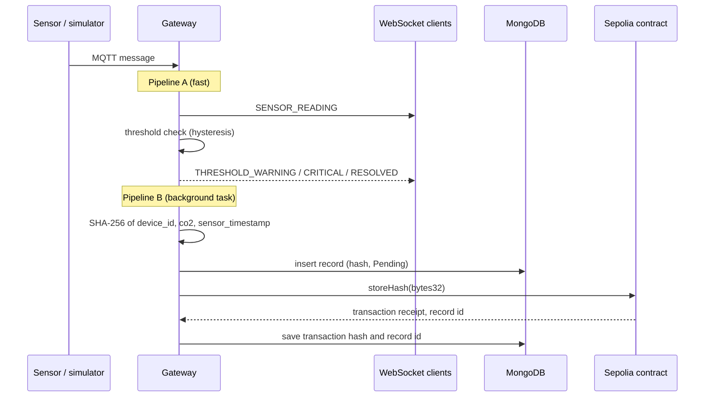

# CarbonMonitor architecture

This document describes how a sensor reading travels through the system, what is stored where,
how integrity is checked, and how access is controlled. For setup, see the [README](../README.md);
for the sensor node, see the [hardware guide](HARDWARE.md).

## 1. Components

| Component | Role | Code |
|---|---|---|
| Sensor node | Reads the MQ-135, publishes JSON over MQTT. Nothing else runs on the device. | `ESP32/main/` |
| Broker | Mosquitto, authenticated, one topic shared by all devices | `mosquitto.conf` |
| Gateway | FastAPI: MQTT bridge, alerting, hashing, storage, blockchain, REST and WebSocket | `Gateway/` |
| Database | MongoDB | collections listed in section 5 |
| Smart contract | Stores one `bytes32` hash per record | `contracts/CarbonMonitor.sol` |
| Dashboard | React single-page app | `Dashboard/` |

## 2. Two independent pipelines

Every MQTT message is handled twice, by two paths that do not wait on each other.



- **Pipeline A** broadcasts the reading and evaluates the threshold. It never touches MongoDB, the
  hash or the chain, so an alert is never delayed by them.
- **Pipeline B** runs as its own asyncio task, spawned only after the message passed validation.
  A failure here is logged and reported as an event, and never reaches Pipeline A.
- **MQTT bridging.** paho-mqtt is synchronous, so it runs in its own thread (`loop_start()`) and
  hands messages to the asyncio loop through a queue. Callbacks are never awaited directly.
- **Chain submission** uses the gateway's own wallet. The nonce is fetched once at startup and
  incremented locally under a lock, and at most three transactions are in flight at once, to stay
  within RPC rate limits. A burst of readings therefore queues and shows as *Pending* until confirmed.

## 3. Message format

One MQTT topic (`carbon/sensor01` by default) is shared by every device, real or simulated;
`device_id` is the only thing that distinguishes them.

Simulated devices and calibrated hardware send:

```json
{ "device_id": "sim-bayview-01", "co2": 842.5, "sensor_timestamp": "2026-11-24T09:34:00.037602+00:00" }
```

The physical node also sends its raw measurement and a calibration status:

```json
{ "device_id": "esp32-01", "sensor_timestamp": "2026-11-24T10:02:45.840006Z",
  "raw_adc": 193, "v_pin": 0.155, "co2": null,
  "demo_ppm": 563, "calibration_status": "DEMO_ESTIMATE", "measurement_type": "ADC_DERIVED_DEMO" }
```

`calibration_status` is `CALIBRATED` (a real `co2`), `UNCALIBRATED` (`co2: null`) or `DEMO_ESTIMATE`
(see section 6).

## 4. Hashing and verification

**What is hashed.** SHA-256 over exactly three fields, joined with `|`:

```
device_id | float(co2) | sensor_timestamp
```

`co2` is coerced to a float first, so `700` and `700.0` hash identically. The gateway's own receive
time and the factory a device belongs to are stored beside the record but are **not** part of the
hash, so they can change without invalidating anything.

**What goes on-chain.** The 32-byte hash, via `storeHash(bytes32)`, under an auto-incrementing record
id, emitting `HashStored`. The contract has no verification function; comparing hashes costs nothing
off-chain, so it is done in `Gateway/verification.py`.

**Verifying a record.** The gateway re-reads the record, recomputes the hash from its *current*
`device_id`, `co2` and `sensor_timestamp`, fetches the immutable hash from the contract with
`getHash(record_id)`, and compares them (normalising the `0x` prefix first). The result is one of:

| Status | Meaning |
|---|---|
| `Verified` | Recomputed hash equals the on-chain hash: the data is unchanged since anchoring |
| `Tampered` | The hashes differ: the stored data was altered after it was anchored |
| `NotAnchored` | The record has no on-chain hash yet (still pending) |
| `NotFound` | No such record, or it is outside the caller's region |
| `Error` | The check could not be completed (for example the chain was unreachable) |

A `Tampered` result raises a critical `TAMPERING_DETECTED` event. A scheduler additionally
re-verifies a small, fixed sample of the most recently anchored records on a long interval
(`VERIFICATION_INTERVAL_MINUTES`), deliberately small so it cannot recreate RPC rate-limit problems.

## 5. Alerting

Each reading is classified `NORMAL` (below the warning threshold), `WARNING` or `CRITICAL`, using
`CO2_WARNING_THRESHOLD` and `CO2_CRITICAL_THRESHOLD`. Alerts have a two-state life cycle per device,
**ACTIVE → RESOLVED**, with no manual acknowledgement step on the alert itself:

- A reading at WARNING or CRITICAL with no active alert opens one and emits `THRESHOLD_WARNING` or
  `THRESHOLD_CRITICAL`.
- While an alert is active, further readings at the same or a lower severity are swallowed (the
  cooldown); only escalation produces a new event.
- A run of `CO2_HYSTERESIS_READINGS` consecutive readings back below the warning threshold resolves
  it with `THRESHOLD_RESOLVED`. A reading that goes back up resets that count.

A warning or critical event also becomes a saved **notification** for the device's region (see
section 7), which can be marked *seen* or *acknowledged* by users.

A device that is silent for `DEVICE_TIMEOUT_SECONDS` raises `DEVICE_OFFLINE`, and `DEVICE_ONLINE`
when it speaks again.

## 6. Demo estimates (physical sensor before calibration)

An MQ-135 produces a CO₂ value only once `MQ135_R0` has been calibrated in clean air. Until then the
firmware has no honest number to send, so it sends `co2: null` and, for the presentation, a separate
`demo_ppm`: a linear rescale of the raw ADC value (400 at the observed indoor baseline, 1000 at the
observed smoke peak, rising along the same line above that). It is **not** a CO₂ measurement.

The gateway keeps these readings apart from real data:

- They are broadcast to the dashboard but **never** reach the threshold engine, Pipeline B or
  `sensor_data`, for any device. `co2` is never filled in from `demo_ppm`.
- A malformed `demo_ppm` is downgraded to a plain uncalibrated reading. For the hardware node
  (`esp32-01`), a missing or unrecognised status is treated as uncalibrated, never as calibrated.
- They are hashed and anchored by a separate background task and saved in the **`demo_readings`**
  collection, flagged as demo records, so verification, analytics, the scheduler and the record counts
  (all of which read `sensor_data`) never see them.
- The dashboard shows them as "demo ppm", against display-only bands (below 600 normal, 600 to 800
  warning, above 800 critical) that are defined in `Dashboard/src/lib/demoBands.js` and are not the real
  thresholds. A demo reading crossing into the critical band raises a notification that exists only
  in the browser; no real alert or saved notification is created.

## 7. Data model

| Collection | Holds |
|---|---|
| `sensor_data` | One document per real reading: `device_id`, `co2`, `sensor_timestamp`, `gateway_received_timestamp`, `hash`, `verification_status`, `blockchain_tx_hash`, `blockchain_record_id`, `factory_id` |
| `demo_readings` | Demo estimates only, with the same hash and transaction fields plus `demo_ppm`, `raw_adc` and `v_pin` |
| `users` | Accounts: unique username and email, bcrypt password hash, role, region |
| `regions`, `factories`, `devices` | The hierarchy a reading belongs to: region → factory → device (flagged hardware or simulated) |
| `notifications` | Saved alerts per region, with seen and acknowledged state |

`sensor_data` has a compound index on `{device_id, sensor_timestamp}`. Collections and indexes are
created by the one-off `Gateway/migrate_schema.py`, not at gateway startup, which keeps schema work off
the hot path.

## 8. Access control

- **Authentication:** `POST /api/auth/login` returns a signed JWT (HS256, default lifetime 8 hours).
  The token is decoded and validated on every request; the user is not re-read from the database, so
  deactivating an account or changing its role takes effect at that user's next login.
- **Roles:** exactly two. `admin` has no region and sees everything; `regional_head` has a region and
  sees only that region's factories, devices, readings, records and notifications. The rule lives in
  one function (`region_scope_filter()`) that every region-scoped route uses.
- **Not-yours looks like not-found:** a regional head asking for another region's device or factory
  gets `404`, never `403`.
- **No self-registration:** the first admin is created with `Gateway/create_admin.py`, and only an
  admin can create further users.
- **Live data is scoped too.** WebSocket clients join a room (the admin room, or their own region's),
  and each event is delivered only to the admin room and the matching region.

## 9. REST and WebSocket surface

| Area | Endpoints |
|---|---|
| Auth | `POST /api/auth/login`, `POST /api/auth/change-password` |
| Readings | `GET /api/readings/{device_id}`, `GET /api/analytics/{device_id}`, `GET /api/demo-readings` |
| Records | `GET /records`, `GET /records/stats`, `POST /verify/{record_id}` |
| Organisation | `GET /api/factories`, `GET /api/factories/{id}/devices`, `GET /api/regions/me`, `GET /devices/status` |
| Notifications | `GET /api/notifications`, `POST /api/notifications/{id}/seen`, `POST /api/notifications/{id}/acknowledge` |
| Admin | `/api/admin/users`, `/api/admin/regions`, `/api/admin/factories`, `/api/admin/devices` (list, create, update, delete) |
| Health | `GET /health` (public: broker address and thresholds only) |
| Live | WebSocket `/ws` (events) and `/ws/notifications`, each authenticated with `?token=` |

Interactive API documentation is served by the gateway at `/docs`.
